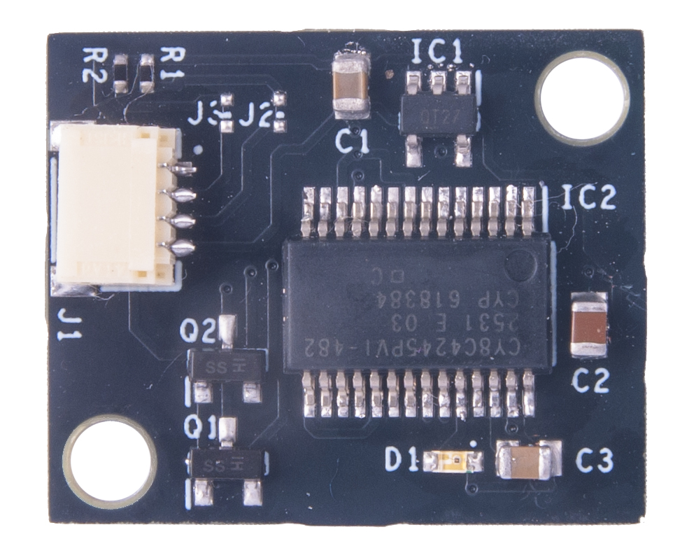
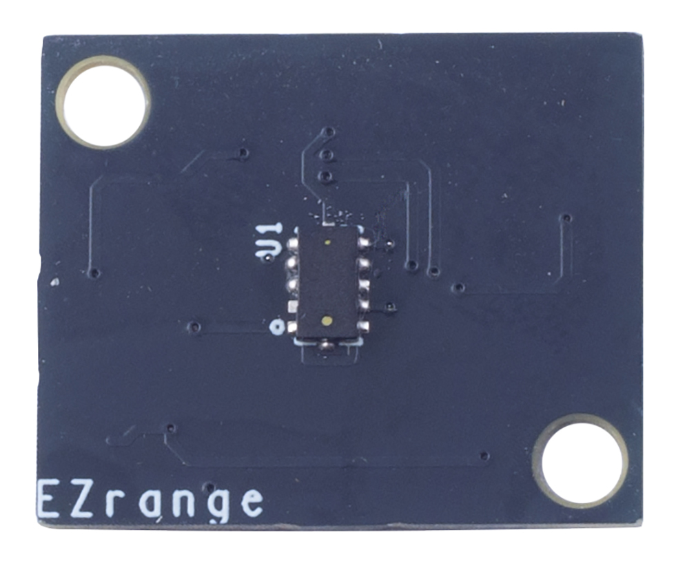

# EZrange VL53L0X breakout API for MCU ports

This directory preserves the STM VL53L0X API tree and adds a portable MCU
platform implementation for the EZrange I2C forwarding breakout firmware.

## Breakout board

The EZrange breakout is an I2C bridge for a VL53L0X sensor. Its PSoC presents
a programmable I2C address to the host and forwards register writes and read
requests to the sensor on a separate I2C bus. The default host address is
`0x29`; address changes are stored in EEPROM and restored after reset. The
sensor itself remains responsible for distance measurements.

At startup, the red LED indicates the stored address by blinking. The firmware
then enters low-power sleep between I2C transactions.

| Front | Back |
| --- | --- |
|  |  |

## Build selection

Add the five `core/src/*.c` files and these two platform files to the MCU
project:

- `platform/src/vl53l0x_i2c_platform.c`
- `platform/src/vl53l0x_mcu_platform.c`

Add `core/inc` and `platform/inc` to the compiler include paths.

Do not compile the Windows-specific `platform/src/vl53l0x_platform.c`,
`platform/src/vl53l0x_i2c_win_serial_comms.c`, or
`platform/src/vl53l0x_platform_log.c` in this configuration. The MCU bridge
replaces the first file; the second is an alternative Windows transport. Keep
API logging disabled unless a separate MCU logging implementation is provided.
The original files remain in the tree for reference.

## MCU adapter

Implement the five `VL53L0X_Port_*` functions declared in
`platform/inc/vl53l0x_i2c_platform.h`. All hooks return zero on success and a
nonzero value on failure. I2C operations must block until the full transfer
finishes, use the supplied 7-bit address, transfer exactly the requested bytes,
and terminate each transaction with STOP. Add a bounded timeout in the MCU
driver; a stalled bus must not block forever. `VL53L0X_Port_I2C_Init` receives
the requested speed in kHz; a speed of zero means retain the driver default.
The upstream microsecond-delay hook is implemented by rounding up to a whole
millisecond; provide a finer-grained implementation if the application needs
microsecond timing.

The public STM API convention is preserved: set `Dev->I2cDevAddr` to the
8-bit shifted address (for example, `0x52` for 7-bit address `0x29`). The port
converts this to 7-bit form before calling the MCU hooks.

## Breakout-specific behavior

The breakout uses a one-byte register index and forwards transactions to its
downstream sensor. Reads select the register, wait, perform a first read to
trigger forwarding, wait again, then read the response. Writes send the
register index followed by the payload. The fixed 1 ms waits are transport
timing for this firmware, not part of the generic STM API; validate them with
the actual hardware before changing them.

Transfers are limited to 63 payload/read bytes because the breakout buffer is
64 bytes and writes include the register index. `VL53L0X_cycle_power`, GPIO
hooks, and timer hooks report unsupported. Sequence lock functions are no-op;
serialize API access in the application if tasks or interrupts can access the
same bus concurrently.
